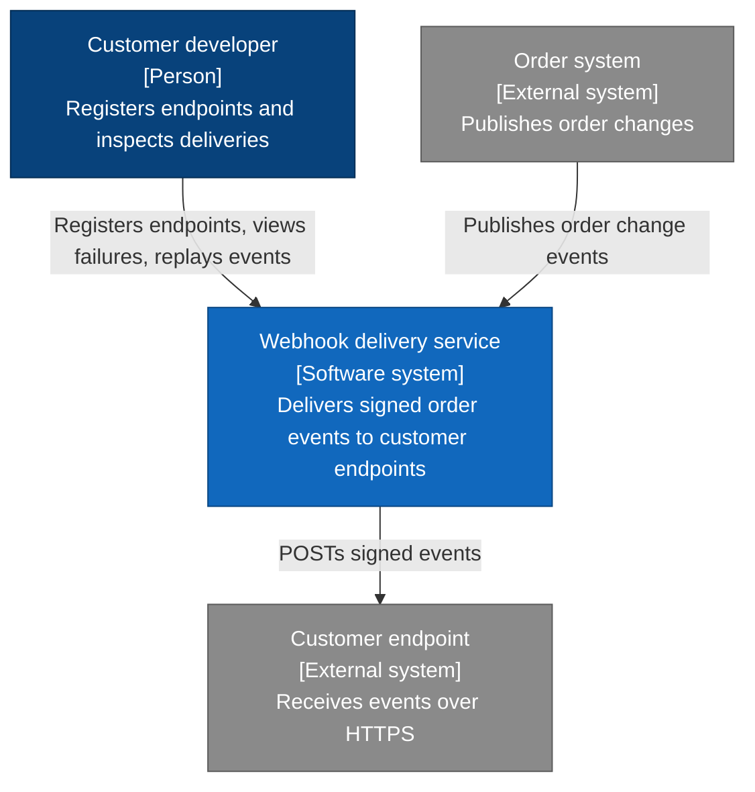

# Level 1: Context

Zooms into: — · Status: approved 2026-11-10

## Diagram
Webhook delivery system context. Blue is the system being designed; grey is existing or external.

## Elements
| Element | Type | Technology | Responsibility |
| --- | --- | --- | --- |
| Customer developer | Person | — | Registers endpoints, inspects and replays failed deliveries |
| Webhook delivery service | System | — | Delivers signed order events to customer endpoints |
| Order system | External system | — | Publishes order changes |
| Customer endpoint | External system | — | Receives events |

## Relationships
| From | To | Purpose | Protocol | Failure behaviour |
| --- | --- | --- | --- | --- |
| Customer developer | Webhook service | Manage endpoints and replay | — | Developer sees an error; deliveries continue |
| Order system | Webhook service | Publish order changes | — | Events buffer upstream until the service consumes |
| Webhook service | Customer endpoint | Deliver events | — | Retry, then dead letter |

## Deferred to the next level
- Storage, queueing, retry scheduling, signing key management.
