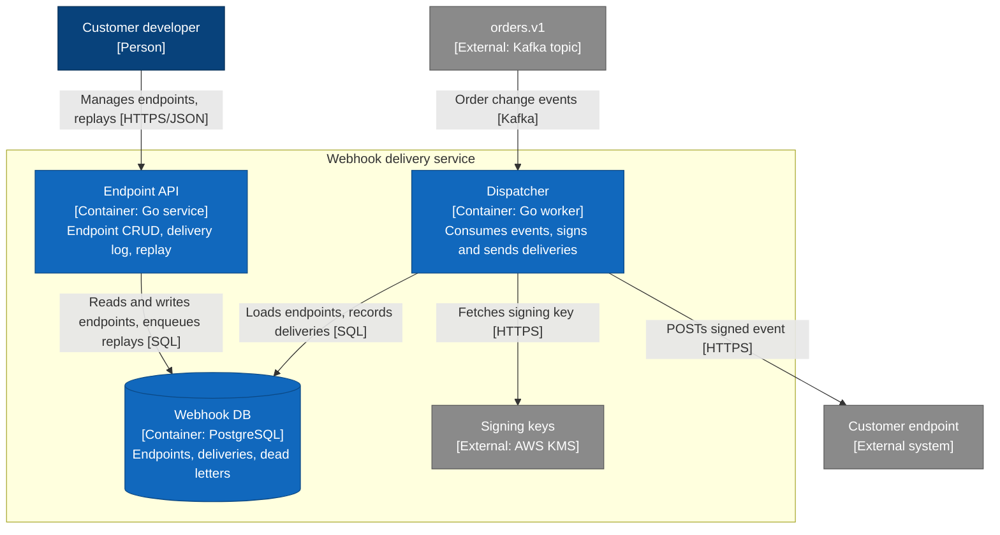

# Level 2: Containers

Zooms into: [Webhook delivery service](1-context.md) · Status: approved 2026-11-12

## Diagram
Containers of the webhook delivery service.

## Relationships
| From | To | Purpose | Protocol | Failure behaviour |
| --- | --- | --- | --- | --- |
| Dispatcher | Customer endpoint | Deliver | HTTPS | Non-2xx or timeout schedules a retry |
| Dispatcher | Webhook DB | Record attempts | SQL | Dispatcher stops committing Kafka offsets |
