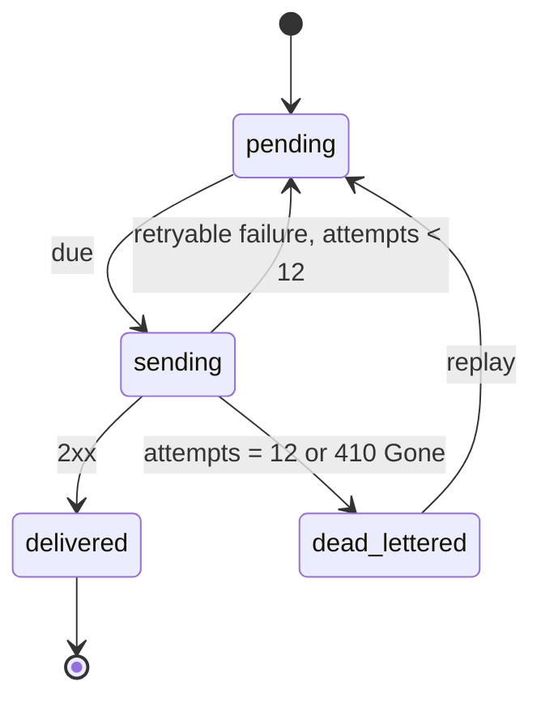

# Level 4: Code of Retry scheduler

Zooms into: [Retry scheduler](../3-components/dispatcher.md) · Status: approved 2026-11-14



Backoff: 30s doubling, capped at 1h, 12 attempts (about 8 hours total).

```go
type Scheduler interface {
    // Due returns up to limit deliveries whose next attempt time has passed.
    Due(ctx context.Context, limit int) ([]Delivery, error)
    // Record applies an attempt result and computes the next state.
    Record(ctx context.Context, id DeliveryID, result AttemptResult) error
}
```
