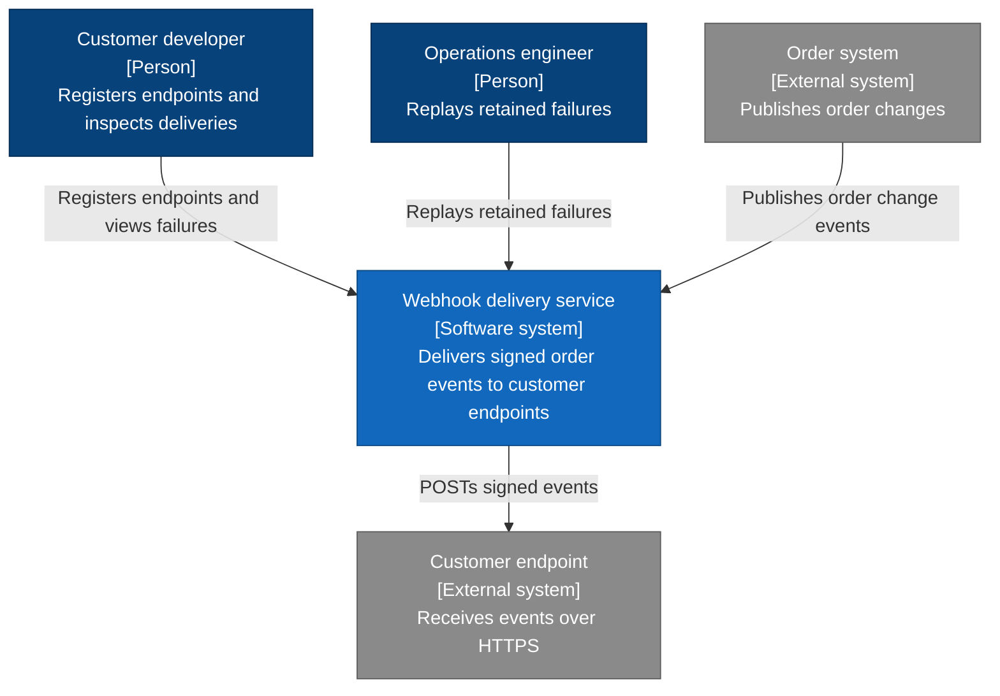

# Level 1: Context

Zooms into: — · Status: in review

## Diagram
Webhook delivery system context. Blue is the system being designed; grey is existing or external.

## Elements
| Element | Type | Technology | Responsibility |
| --- | --- | --- | --- |
| Customer developer | Person | — | Registers endpoints and inspects failed deliveries |
| Operations engineer | Person | — | Replays retained failures internally |
| Webhook delivery service | System | — | Delivers signed order events to customer endpoints |
| Order system | External system | — | Publishes order changes |
| Customer endpoint | External system | — | Receives events |

## Relationships
| From | To | Purpose | Protocol | Failure behaviour |
| --- | --- | --- | --- | --- |
| Customer developer | Webhook service | Manage endpoints and inspect deliveries | — | Developer sees an error; deliveries continue |
| Operations engineer | Webhook service | Replay retained failures | — | Operator sees an error; retained events remain available |
| Order system | Webhook service | Publish order changes | — | Events buffer upstream until the service consumes |
| Webhook service | Customer endpoint | Deliver events | — | Retry, then dead letter |

## Deferred to the next level
- Storage, queueing, retry scheduling, signing key management.

## Review history
The user rejected a draft that let customer developers request direct replay. The revised diagram retains endpoint registration and inspection, while replay is now an internal operational action deferred to Level 2. Awaiting approval of this revision.
