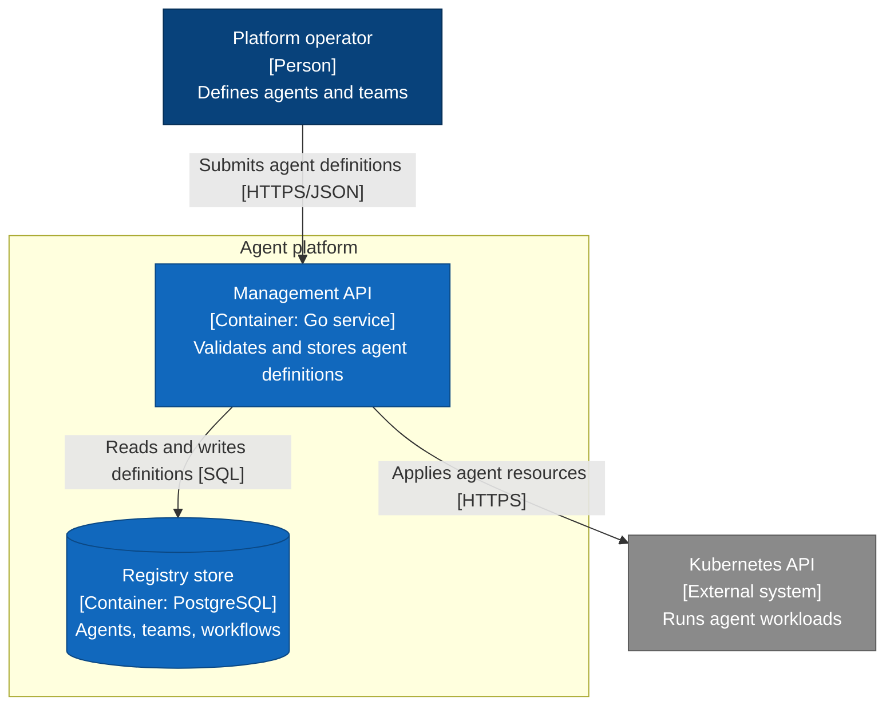

# C4 level guide

Each level zooms into one element of the level above. Read the section for the level you are entering. The loop that uses these sections is in [SKILL.md](../SKILL.md).

## Diagram conventions (all levels)

Write diagrams as Mermaid in fenced blocks inside the level's markdown file, so they render in GitHub and editor previews and diff as text. Use `flowchart` for levels 1 to 3; it renders more reliably than Mermaid's experimental C4 syntax.

- Node label: name, then type and technology in brackets, then a one-line responsibility.
- Edge label: verb phrase, then protocol in brackets from level 2 down. Arrows point in the direction of the call or dependency, with one direction per edge.
- A `subgraph` is the boundary of the element being zoomed into. Elements outside it are neighbours, drawn without their internals.
- Apply the shared classes below so the same kind of element looks the same in every diagram.
- Keep a diagram to roughly fifteen elements. Past that, split by boundary or scenario.
- Give every diagram a title line and a one-sentence legend beneath it.

## Level 1: System context

**Scope.** The system as one box, the people who use it and the external systems it depends on or serves. No internals, no technology inside the box.

**Elements.** Person (a role, not an individual), the system, external systems (anything the team does not build or operate as part of this design, including adopted platforms and third-party services).

**Grill for.**

- Who uses it, in which roles, and what each is trying to get done? Which role matters most?
- What is inside the system boundary, and what is an external system the design adopts as is?
- What does the system call, and what calls it? Which of those already exist?
- What data crosses the boundary, in which direction, and who owns it?
- Who is trusted, how do they authenticate, and who must be kept out?
- What happens to users when each external system is unavailable?
- What is explicitly out of scope for this design?

**Exit checks.** Every person and external system has a labelled relationship to the system. Every goal in `DESIGN.md` is visible as at least one relationship. The boundary answers "do we build this or use it" for every named technology in the proposed solution.

## Level 2: Containers

**Scope.** Inside the system boundary: each separately deployable or runnable unit and each data store, with the technology chosen and how they communicate.

**Elements.** Container: service, web or CLI application, worker, controller or operator, database, queue, object store. A C4 container is an application or data store, independent of how it is packaged or deployed. Kubernetes CRDs define API schemas; document them as contracts of the API/controller and show the relevant storage boundary. The controller/operator is a runnable container; a CRD is not. Level 1 people and external systems reappear as neighbours. See the [C4 container definition](https://c4model.com/abstractions/container).

**Grill for.**

- What are the deployable units, and why is each one separate (scaling, failure isolation, ownership, release cadence, security boundary)?
- What technology does each use, and what alternative was rejected?
- Where does each piece of state live, and which single container owns writes to it?
- How does each pair communicate: synchronous or asynchronous, which protocol, who initiates?
- Where are the trust boundaries, and how is identity carried across each hop?
- What fails when each container is down, and what keeps working?
- How is it deployed, configured, upgraded and observed?
- For an adopted platform, which parts are configured and which are extended with custom code?

**Exit checks.** Every level 1 relationship lands on a specific container. Every container has a technology, one owner of each store is identified, and every edge has a protocol. A request for the main scenario can be traced container to container.

## Level 3: Components

**Scope.** Inside one container: the major structural parts, their responsibilities and their interfaces. Run once per container the team builds. A container that is adopted unmodified, or a plain data store, needs no component diagram; record that choice.

**Elements.** Component: a module, package or group of code behind an interface, such as an API handler set, a reconciler, a domain service, a repository, an adapter to an external system. Neighbouring containers appear as single boxes.

**Grill for.**

- What are the responsibilities of this container, and which component holds each one?
- What is each component's interface, and what does it hide?
- Which direction do dependencies run, and where are the seams for testing and replacement?
- Which component owns each external call and each store access?
- Where are validation, authorization, retries, idempotency and error translation handled?
- What runs concurrently, and what state is shared?
- Which components carry the real complexity or risk?

**Exit checks.** Every level 2 edge touching this container lands on a specific component. Each component has one stated responsibility and dependencies form no cycle. The user can name which component they would open to change a given behaviour.

## Level 4: Code

**Scope.** Inside one component: the types, interfaces, data shapes and state that implementers must agree on before writing it. This is a design of contracts, not a drawing of every class. Run for the components the user selects; recommend those with public contracts, persistent schemas, state machines, concurrency or nontrivial algorithms, and record the ones left to implementation.

**Diagrams.** Choose the Mermaid type that fits the content: `classDiagram` for types and interfaces, `erDiagram` for stored data, `stateDiagram-v2` for lifecycles, `sequenceDiagram` for call order within the component. Pair diagrams with the actual signatures or schemas in code blocks in the project's language.

**Grill for.**

- What are the public interfaces and their exact signatures? What do callers need to know and nothing more?
- What are the core types and their invariants? Which states are legal, and what moves between them?
- What is the stored schema, its keys and its versioning or migration path?
- What errors exist, which are retryable, and how do they surface to the caller?
- What is the concurrency model, and who owns each resource's lifetime?
- How is each piece tested, and what is faked at the seam?
- Which project conventions (layout, naming, error handling) apply?

**Exit checks.** Every level 3 interface of the component in scope has a concrete signature or schema. Every state machine shows its terminal and failure states. An implementer could write the first test for this component from the doc alone. Components deliberately deferred retain their level 3 contracts and a recorded reason for deferral.

## Supporting view: Deployment

Use when placement, identity or infrastructure failure boundaries affect the architecture, such as a Kubernetes platform spanning namespaces or clusters. This supplements the logical levels; it is not a fifth level. See the [C4 deployment diagram guidance](https://c4model.com/diagrams/deployment).

**Scope.** One named environment, such as production. Show instances of the existing containers inside nested deployment nodes using Mermaid `flowchart` subgraphs. Keep logical container names recognizable and distinguish replicas from separate containers.

**Grill for.**

- Where does each container run, and what infrastructure or managed service hosts it?
- Which cluster, namespace, zone or host boundaries affect placement and failure isolation?
- Which identities, permissions, ingress and network boundaries govern communication?
- What happens when a replica, node, zone or external dependency fails?
- How do rollout, rollback and recovery preserve the agreed availability and data guarantees?

**Exit checks.** Each runtime instance maps to a logical container; relevant infrastructure nodes, identity and failure boundaries are explicit. The operational flow agrees with the deployment view and the relevant acceptance criteria. Record and review infrastructure decisions through the same design loop.
